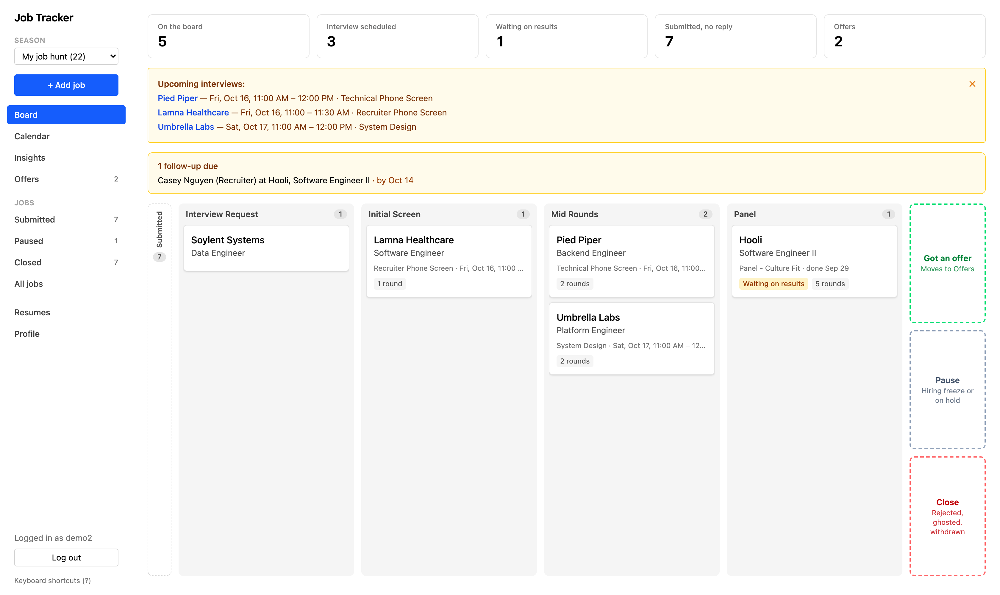
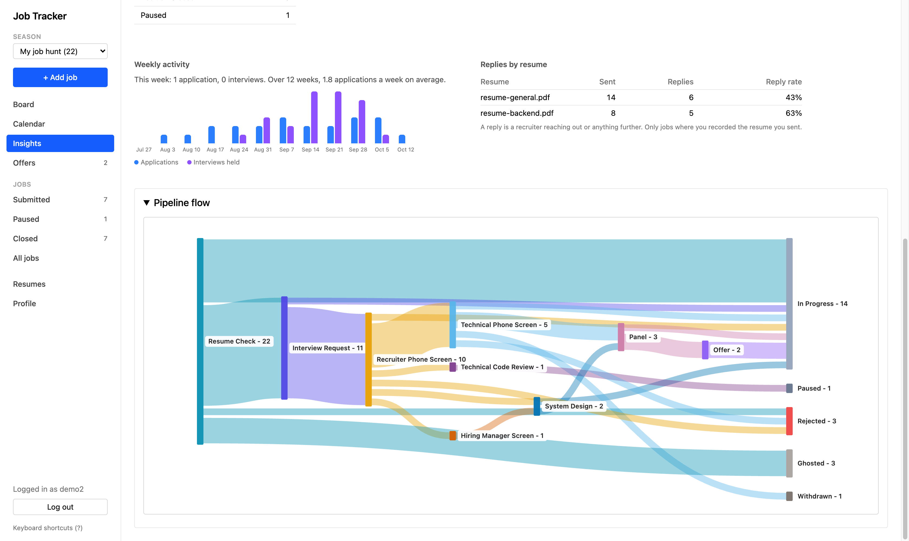
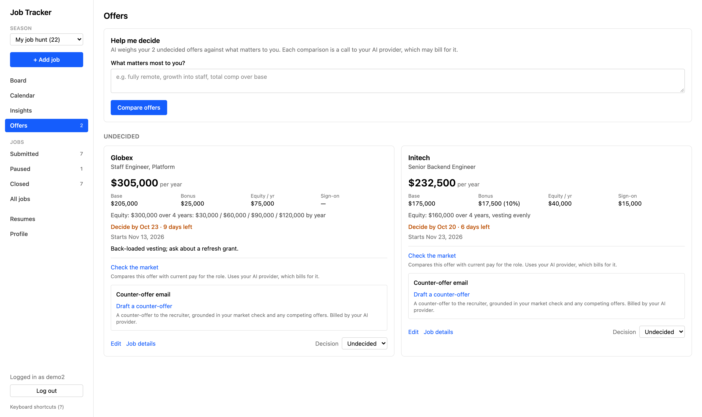
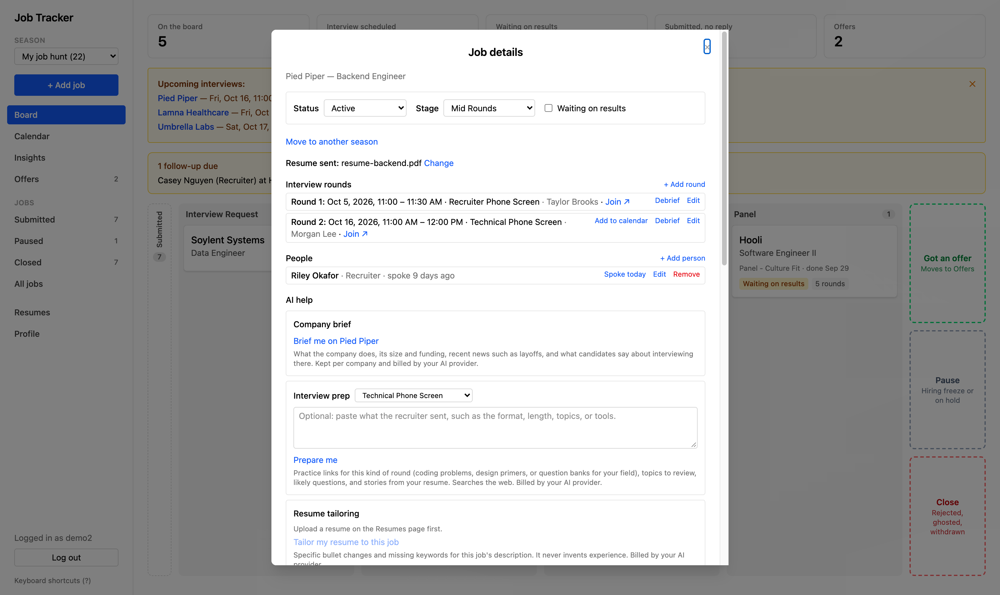

# Job Tracker

A job-search tracker that runs on your own machine. Your resumes, salaries, and rejection notes are
stored there and nowhere else ([what leaves it, and when](#your-data-stays-on-your-machine)), and
there's no account to sign up for and nothing to pay. Active applications live on a
board you drag between interview rounds; everything else has its own page: applications waiting on a
reply, offers, paused searches, and closed ones. An interview calendar and an Insights page show how
the search is going, down to a Sankey of where every application went.



| | |
|---|---|
|  |  |
| **Insights**: weekly pace and where every application went | **Offers**: yearly totals, equity by year, and deadlines |

Try it with made-up data first: an empty board offers **Try it with sample data**, removable in one
click. Coming from a spreadsheet? **Import from a spreadsheet** brings it in, dates and all.

**How it compares.** Hosted trackers such as Huntr and Teal are quicker to start and work on your
phone, but your search lives on their servers and some features sit behind a paid plan. A spreadsheet
is private and free but leaves the reminders, the calendar, and the counting to you. This sits
between them:

| | Job Tracker | Hosted tracker | Spreadsheet |
|---|---|---|---|
| Where your data lives | Your machine | Their servers | Your file |
| Cost | Free, open source | Free tier, paid plan | Free |
| Board, calendar, reminders, pipeline stats | Yes | Yes | By hand |
| Save a posting | Paste its link or its text | Browser extension | Copy and paste |
| AI help | Optional: your own key, or a local model | Built in, on their plan | No |
| Setup | Docker and one script | Sign up | None |
| On your phone | Only once you [host it yourself](#deploying-to-your-own-cloud) | Yes | Yes |

> 🤖 **This app has optional AI features.** Upload a resume and have it summarized at a press; adding a
> job can then give a short **apply / don't apply** recommendation: the key reasons, any gaps, and which
> resume to use.
> It can also brief you on a company, prepare you for a round and debrief it, draft follow-up and
> counter-offer emails, tailor a resume to a job, and spot patterns across your search. Each is a
> button whose answer is saved, so nothing runs or bills on its own. It runs on the AI provider you
> choose: Anthropic, OpenAI, Gemini, and others, or a model on your own machine. See
> [AI features](#ai-features-optional).

> ⚠️ **This app does not apply to jobs for you.** It tracks applications you submit yourself, and
> never sends one, contacts an employer, or acts on a posting on your behalf. An AI recommendation is
> a suggestion to read, nothing more.

It runs entirely in Docker: one command starts the web app, three backend services, Postgres, and
MongoDB on any machine with Docker. No local Node, Java, Go, or database install.

## Contents

- [Your data stays on your machine](#your-data-stays-on-your-machine)
- [What it does](#what-it-does)
- [Quick start](#quick-start)
- [Architecture](#architecture)
- [Security between layers](#security-between-layers)
- [Configuration](#configuration)
- [Windows](#windows)
- [Deploying to your own cloud](#deploying-to-your-own-cloud)
- [Troubleshooting](#troubleshooting)
- [Tech stack](#tech-stack)
- [Changelog](#changelog)
- [License](#license)

## Your data stays on your machine

Everything you enter (jobs, notes, interviews, offers, resumes, and images) is stored in Docker
volumes on the computer running the app. There's no account with this project, no cloud copy, and no
analytics or tracking of any kind. `.env`, which holds your passwords and keys, and `certs/` are made on
your machine and never uploaded. (Host it on a server and "your machine" is that server.)

The app connects to the outside only in these cases, and the update check is the only one that runs
on its own:

- **Reading a posting link you paste.** The scraper fetches that posting from the site it's on, as
  your browser would.
- **The daily update check.** It asks GitHub for this project's list of released versions and sends
  nothing about you or your data. `UPDATE_CHECK=false` in `.env` turns it off.
- **AI, only if you set up a provider and press an AI button.** What that feature needs (a job
  description, your notes, a resume, or offer numbers) goes to the provider you chose, on your own
  account. With Ollama or LM Studio it stays on the machine.
- **Email, only if you set up a mail account.** Reminders, with the job, company, and interview time,
  go out through the account you configured.

Installing and updating download the app's public images; nothing is sent the other way. A link you
click in the app, such as a meeting link or a map, opens in your browser like any other link.

**Setting it up with an AI assistant**, such as Claude Code with this repo's `CLAUDE.md`: the commands
it runs work on your machine. `sh setup.sh` makes random secrets locally and makes no network calls
(CI runs it with networking switched off to prove it), and it reports each secret as made or kept
without ever printing one. `docker compose` downloads the app's images and starts them. Neither sends
your data anywhere. The assistant is a separate tool: what it reads and runs goes to its own AI
provider, as with any task you give it. So this repo keeps your keys out of it:

- `.claude/settings.json` makes Claude Code refuse to read `.env`, `certs/`, or a backup file, and
  refuse the commands that would print your settings (`printenv`, `docker inspect`,
  `docker compose config`).
- `CLAUDE.md` tells it never to look at your job data, and never to ask you to paste a key or password
  into the chat: you put those in `.env` yourself, in an editor.

## What it does

**Board.** The home page holds the jobs you're actively working, in four columns: **Interview
Request** (a company replied or asked to talk), **Initial Screen**, **Mid Rounds**, and **Panel**. Drag a card
to move it, or use the keyboard: Space picks a card up, the arrow keys move it between columns, and
Enter opens it. Cards show the latest round and two badges:

- **Waiting on results**: you've interviewed and are waiting on a verdict.
- **Schedule round**: they've asked for the next round and it isn't on the calendar yet. It appears
  and clears on its own as you add rounds.

Beside the columns are three exits: drop a card on **Got an offer**, **Pause**, or **Close** to move
it off the board. On the left, a collapsible **Submitted** tray holds applications waiting on a
reply: open it and drag one onto a column when they answer, or drag a card back into it.

**The other pages:**

- **Submitted**: applications still waiting on a reply, kept off the board so they don't crowd it.
  **Got an interview request** puts one on the board. After 30 days with no reply, one is flagged
  and can be marked ghosted, alone or all together.
- **Offers**: each offer's base, bonus (in dollars or as a percent of base), equity, sign-on, start
  date, and decision deadline, with an average per year (everything it pays, sign-on included, over the
  same years for every offer), and a **Decision** (Undecided, Accepted, Declined) you can change later. Equity is entered
  as the letter gives it: shares and a share price, or a dollar value, the years it vests over, and an
  even or custom schedule. The sign-on is entered per year, for one paid over two years. **Pay by
  year** shows what each year actually pays with that year's vesting and sign-on. An **Offered title** records a different title or level than
  the posting's, such as after a downlevel. With AI set up, **Check the market** says whether an offer
  is below, at, or above typical pay for the title offered, with points to negotiate, and **Help me
  decide** weighs the undecided offers against priorities you write in, and **Draft a counter-offer**
  writes the email to the recruiter from that evidence.
- **Paused**: hiring freezes and holds. **Resume** puts a job back exactly where it was.
- **Closed**: rejected, ghosted, withdrawn, and closed-position jobs, filterable by outcome.
- **All jobs**: every job in one sortable, filterable, resizable table, editable in place, for
  scanning and bulk edits. A set of filters can be saved under a name, such as "remote, still
  active". **Import from a spreadsheet** brings in a search you've been tracking elsewhere: save the
  sheet as CSV, check how the columns are matched, and each job arrives with its date applied and how
  far it got. **Download as a spreadsheet** writes the same columns back out, so your data is never
  stuck here.
- **Calendar**: the interview rounds you log, with times, meeting links, location, and interviewers.
  An upcoming-interviews banner shows what's in the next few days. You enter the rounds; it doesn't
  book anything. **Add to calendar** downloads a round, or every upcoming one, as a file your own
  calendar app opens.
- **Insights**: headline numbers (applications, response rate, interviews done and upcoming, round
  pass rate), a stage funnel, how each interview type tends to go, applications and interviews per
  week, which resume gets the most replies, and a pipeline-flow chart. With AI
  set up, **Find patterns in my search** says what stands out, sending counts and rejection reasons
  but never company names.
- **Resumes**: upload PDF, DOCX, or text resumes. With AI set up each gets a summary; without it you
  can write your own.
- **Profile**: your name, email, and password, and **Notifications**. Email is off until you turn it on; then you pick
  from a daily digest, an interview starting within the hour, an offer deadline two days out, and a
  follow-up nudge when a job goes quiet after an interview or a person's follow-up day arrives. Needs
  an email account set up once on the server; see [Email reminders](#email-reminders-optional).

**Seasons.** Each job hunt is a season. Starting a new one from the sidebar's season picker gives you
an empty board, calendar, and Insights for the new search, while the last one's jobs stay, out of
view, until you switch back or choose **All seasons**. A job filed under the wrong one moves from its
dialog. The **Seasons** page, opened from the picker's **Season** heading, compares your hunts side by side (applications, replies, interviews,
offers), renames them, and opens any one's board or Insights. Upgrading puts every job you already
have into a first season called "My job hunt".

**Keyboard.** `/` or Ctrl K finds a job by company, role, or city; `N` adds one; `G` then `B`, `C`,
`I`, or `A` goes to the board, calendar, Insights, or all jobs; `?` lists them all.

**Adding a job.** Paste a posting link and the scraper fills in what it can: company, role, work model
(remote, hybrid, or on-site), city, salary range, and the job description. It reads structured job-board pages, Greenhouse career pages,
and ordinary pages. Or skip the link and type it in; there's always a box for the description, and
**Back** returns to the link. Pasting a description and pressing **Fill in title, location and pay**
fills those if empty, from the text alone (free, AI or not). **Get recommendation** fills an empty
company and role too. You
choose whether it starts as applied or as a recruiter reaching out. With AI set up, a **Company
brief** covers what the company does, its funding, recent news such as layoffs, and what candidates
say about interviewing there; it's kept per company.

Some sites only show a posting to someone signed in, so a pasted link gets nothing.
For those, copy the description from the page and paste it in; the same free reading fills the title,
location, and pay.

**Each job** opens into a dialog with its Status, Stage, and Waiting on results; its interview rounds;
the people for it (recruiter, referrer, hiring manager) with when you last spoke and a day to follow
up by, which the board lists once it comes; which resume you sent; the description, your notes, and the rejection reason; the stage history; image attachments, such as
a screenshot of a design question; and links to related jobs (for example, when a company closes a
posting and moves you to another). With AI set up it also holds the company brief, **Interview
prep** for the kind of round you pick (practice links fitted to the role, such as LeetCode problems
for a coding round or modeling questions for a finance role, plus topics, likely questions, and what
to lead with; paste the recruiter's note about the round and it's built around that), **Resume tailoring** (bullet rewrites for this job, for the resume you pick), and once
there's been an interview a **Follow-up email** draft. Each round has a **Debrief**: a summary and
thank-you email from your rough notes.



## Quick start

Everything runs in **Docker**, so you don't install Node, Java, Go, or the databases yourself. The
only thing you need is **[Docker Desktop](https://www.docker.com/products/docker-desktop/)**,
installed and running.

**1. Get the files.**

```bash
git clone https://github.com/maddaak/jobTrackerApp.git && cd jobTrackerApp
```

Only want to *run* it? Skip git and download three files into a new folder:
[`docker-compose.images.yml`](https://github.com/maddaak/jobTrackerApp/blob/main/docker-compose.images.yml),
[`.env.example`](https://github.com/maddaak/jobTrackerApp/blob/main/.env.example), and
[`setup.sh`](https://github.com/maddaak/jobTrackerApp/blob/main/setup.sh).

**2. Set it up.** This makes `.env` with fresh passwords and keys. It never leaves your machine, and
running the script again never replaces a value you've set.

```bash
sh setup.sh
```

On Windows without Git Bash or WSL, Docker can run it: `docker run --rm -v "${PWD}:/app" -w /app alpine sh setup.sh`.

**3. Start it.**

```bash
docker compose -f docker-compose.images.yml up -d    # pre-built images, nothing to compile
docker compose up -d --build                         # or build from source, for development
```

The first start takes a few minutes while Docker downloads everything; then `docker compose ps`
should show all six services "Up".

**4. Open [http://localhost:5173](http://localhost:5173)** and register. The first account is simply
the first user; there's no shared or default login. To look around before entering your own search,
press **Try it with sample data** on the empty board; **Remove sample data** clears it again.

AI is optional. Leave its settings blank and the AI features are hidden; everything else works. See
[AI features](#ai-features-optional).

> Your data is saved by Docker and survives restarts and updates. It's only deleted if you run
> `docker compose down -v`. Your `.env` and `certs/` stay on your machine and are never uploaded.

### HTTPS (optional)

On the machine running it, plain `http://localhost` is fine: browsers treat it as secure. To use
https, for example to reach it from another device, install
[`mkcert`](https://github.com/FiloSottile/mkcert) (`brew install mkcert`, `choco install mkcert`, or
your Linux package manager), then:

```bash
mkcert -install     # trusts mkcert's certificates in your browser, once
sh setup.sh         # sees mkcert and makes certs/
docker compose -f docker-compose.images.yml up -d --force-recreate web
```

The app then serves `https://localhost:5173`. With a certificate in `certs/` it uses https, and
without one plain http; nothing else changes. If you've set up email, set `APP_URL` in `.env` to the
address you open, so links in emails match.

## Architecture

```
React + TypeScript (Vite), served by nginx (https with a cert)    the only port exposed to the host
        |
TypeScript BFF (Express)          the only service the UI talks to
        |------------------|
Java Spring Boot CORE         Go SCRAPER
 jobs, interviews, offers,     reads a posting link; makes every call
 stage history, metrics,       to the AI provider
 resume storage and text
   |
Postgres (accounts, and the job fields the board and table show)
MongoDB  (per job: everything the job dialog shows, plus resumes and images)
```

**Why each piece:**
- **TypeScript BFF**: the single door the UI talks to (Backend-for-Frontend). It holds the login
  session and is the only service that talks to both core and the scraper; they never call each
  other.
- **Java / Spring Boot**: the core rules: jobs, stages, interviews, offers, metrics, and resume
  storage and text extraction.
- **Go**: the scraper for job postings, and every outbound AI call. Both are "fetch something from
  the outside world", so they live together.
- **Postgres**: accounts and exactly the job fields the board and table sort and filter on: company,
  role, link, how you applied, location and city, salary range, stage, interview phase, and status.
- **MongoDB**: one document per job for everything the job dialog shows: the description, notes,
  stage history, interview rounds with their interviewers, offer details, and links. Resumes and
  image attachments live here too. A job has a varying number of rounds, each with a varying number
  of interviewers, which fits a document better than three joined tables.

## Security between layers

- Only the **web** container publishes a port. The rest sit on private Docker networks, and each
  reaches only its neighbours: web the BFF, the BFF core and the scraper, core the two databases. The
  scraper, which reads outside web pages, can't reach core or the databases, and the databases have no
  internet access.
- Calls from the BFF to core carry `INTERNAL_TOKEN`, and calls to the scraper carry its own
  `SCRAPER_TOKEN`; each rejects any request without its token, and none starts with a `.env.example`
  placeholder still in place. Only the BFF holds both.
- Accounts use a signed JWT in an HTTP-only cookie, checked on every request except `/health` and
  `/auth/*`. Core scopes every job, resume, and image to the signed-in account.
- Each token carries the account's session version, which the BFF checks with core on every signed-in
  request. A new password, or **Sign out other devices**, moves the version on, so every older token
  stops working at once.
- A request that changes something is refused unless the browser says it came from the app's own pages.
- The published port answers on this machine only unless `BIND_ADDRESS` says otherwise; see
  [Before it faces the internet](#before-it-faces-the-internet) for hosting it.
- Secrets come from a gitignored `.env`, never hardcoded or baked into images.
- The scraper refuses to fetch internal addresses (private ranges, cloud metadata, localhost in any
  spelling), checks again on every redirect, and pins each connection to the address it checked, so
  a pasted link can't be used to reach inside your network.
- The browser only talks to nginx, on one origin (https with a certificate, plain http without), so
  there's no cross-origin surface.

## Configuration

### AI features (optional)

Resume analysis, job-fit recommendations, the offer market check and comparison, company briefs,
interview prep and debriefs, follow-up and counter-offer drafts, resume tailoring, and Insights patterns
run on an AI provider you set in `.env`. Leave the settings blank to run without AI: the app hides those features and shows a short
note instead.

Set `AI_PROVIDER` to the tool, then its key and a model:

| `AI_PROVIDER` | Tool | Key needed | `AI_MODEL` |
|---|---|---|---|
| `anthropic` (default) | Anthropic Claude | yes | optional, defaults to `claude-sonnet-5` |
| `openai` | OpenAI | yes | required |
| `gemini` | Google Gemini | yes | required |
| `mistral` | Mistral | yes | required |
| `deepseek` | DeepSeek | yes | required |
| `groq` | Groq | yes | required |
| `xai` | xAI Grok | yes | required |
| `openrouter` | OpenRouter | yes | required |
| `ollama` | Ollama, on this machine | no | a model you've pulled |
| `lmstudio` | LM Studio, on this machine | no | a model you've loaded |

For example: `AI_PROVIDER=gemini`, `AI_API_KEY=<key>`, `AI_MODEL=<model id>`. Each tool's address is
built in; set `AI_BASE_URL` only when one isn't at its usual place, such as Ollama on another
machine. A hosted tool bills its own account (Anthropic needs billing credit before calls work).

A request asks the provider once. It's retried only when the provider turned it away before doing
any work (rate limited or overloaded), so it can't be billed twice, and it always answers within 100
seconds.

Ollama and LM Studio are free, and your resumes never leave the machine. Raise Ollama's context
length (`OLLAMA_CONTEXT_LENGTH`); its 2048-token default cuts a resume off. Smaller local models
give usable answers less reliably; when one doesn't, the app says the AI is unavailable rather than
showing a bad verdict.

The market check, company brief, and interview prep search the web when the provider can
(Anthropic), and list their sources. Other providers answer from what the model already knows, and
the result is labelled as such. Each makes a few searches, billed by Anthropic on top of the answer.

Each feature runs only when you press its button, and its answer is saved with the job, round, or
account, so looking at it again costs nothing. What's sent is what the feature needs: the job
description, your notes or resume, or offer numbers. A local model keeps all of it on your machine.

A `.env` from before V4, with `ANTHROPIC_API_KEY` and `ANTHROPIC_MODEL`, keeps working. After
changing any AI setting, recreate the scraper so it picks up the new values:

```bash
docker compose up -d scraper
```

### Email reminders (optional)

The app can email you a daily digest, a reminder an hour before each interview, a nudge two days
before an offer's decision deadline, and a follow-up nudge when a job has heard nothing for 7 days
after your last interview (and again at 14). Applications that never got an interview are never
chased. Email is opt-in: each person turns it on, gives their address, and picks which of these they
want under **Profile**, **Notifications**. Follow-ups start off. Times follow their own time zone,
and each reminder is sent once. The reminder address starts as the email given at registration and is
used only for reminders. Password-reset links go to the email under **Profile**, **Account**.

It sends through any SMTP account you set in `.env`. For Gmail:

```bash
SMTP_HOST=smtp.gmail.com
SMTP_PORT=587
SMTP_USERNAME=you@gmail.com
SMTP_PASSWORD=<an app password: Google account > Security > App passwords>
SMTP_FROM=you@gmail.com
```

Use an app password, never your real one. Port 465 connects over TLS; any other port upgrades to TLS
when the server offers it. Then recreate `core` and use **Send a test email** under Profile, Notifications:

```bash
docker compose up -d core
```

Left blank, nothing is sent and the Notifications section says so. Reminders come from `core`, so they only
go out while the app is running: a laptop that's asleep at 8am sends no digest that day. The link at
the foot of each email is `http://<SERVER_NAME>:5173`, which goes on to https when you have a certificate;
set `APP_URL` if you open the app elsewhere.

### Running a specific image version

`docker-compose.images.yml` uses `IMAGE_PREFIX` (default `ghcr.io/maddaak`) and `IMAGE_TAG`
(default `latest`). Set either in `.env` to pin a version or run your own fork's images:

```bash
IMAGE_TAG=v4.0.0
```

To publish images from your own fork, add a new version heading at the top of `CHANGELOG.md` (for
example `## V4.0.1`) and merge it to `main`. Once CI passes on `main`, the `publish-images` workflow
reads that heading, builds each service for amd64 and arm64, pushes them to GitHub Container
Registry as that version and `latest`, and creates the git tag. You can also run the workflow by
hand from the Actions tab, on `main` only. **Don't push the version tag yourself**: the workflow
skips any version whose tag already exists, so a hand-made tag means nothing is published. The first
time, make the packages public in your GitHub Packages settings so others can pull them.

## Windows

The app runs on Windows the same way: everything is in Linux containers, built for amd64 and arm64.
The setup commands above work as written. Two Windows-only notes:

- Use **Docker Desktop with the WSL2 backend** (its default).
- Save `.env` with **LF line endings, not CRLF**. A clone already has LF (the repo says so in
  `.gitattributes`), but Windows editors often save CRLF, which glues a hidden character onto your
  secrets and breaks login. In VS Code, click **CRLF** in the
  bottom-right corner and switch it to **LF** before saving. Editing `.env` inside the WSL2 terminal
  (with `nano` or `vim`) avoids the issue entirely.

## Deploying to your own cloud

The whole app is one `docker-compose.yml` (six containers: `web`, `bff`, `core`, `scraper`,
`postgres`, and `mongo`). Anywhere you can run Docker and the Docker Compose plugin can run it. It's
a single-node setup, not a horizontally scaled one.

### Prerequisites
- A Linux host with Docker Engine and the Docker Compose plugin.
- A domain with a DNS A record pointing at the host's public IP.
- Inbound TCP 443 open to the host.

### 1. Get the code and configure secrets

```bash
git clone https://github.com/maddaak/jobTrackerApp.git && cd jobTrackerApp
```

Run `sh setup.sh`, as in the [Quick start](#quick-start), to make `.env` with fresh secrets. Don't
ship the `change_me` placeholders; the services refuse to start with them. Set the AI settings
too if you want the AI features. `.env` is gitignored and never committed.

### 2. TLS certificate

The `web` container's nginx reads its certificate from `certs/localhost.pem` and
`certs/localhost-key.pem`. For a real domain, put your certificate in under those same names (so no
nginx edit is needed) and set your domain as the server name:

- Get a certificate, e.g. Let's Encrypt: `certbot certonly --standalone -d your.domain`, then copy
  `fullchain.pem` to `certs/localhost.pem` and `privkey.pem` to `certs/localhost-key.pem`.
- Set `SERVER_NAME=your.domain` in `.env`. It's read at startup, so no rebuild is needed (it
  defaults to `localhost`).

`certs/` is gitignored, so it stays on the host. If your cloud already terminates TLS at a load
balancer, leave `certs/` empty: nginx then serves plain HTTP on the same port, for the load balancer
to point at. Have the load balancer send `X-Forwarded-Proto: https`, which nginx passes on, so the
login cookie is still marked secure.

### 3. Expose port 443

Out of the box the app answers only on the machine it runs on (`BIND_ADDRESS=127.0.0.1`), so a laptop
on café Wi-Fi isn't serving it to the room. On a server, open it with `BIND_ADDRESS=0.0.0.0` in `.env`
and map the standard HTTPS port in `docker-compose.yml`:

```yaml
  web:
    ports: ["${BIND_ADDRESS:-127.0.0.1}:443:443"]
```

Behind a proxy or tunnel on the same machine (Caddy, Traefik, Cloudflare Tunnel), leave
`BIND_ADDRESS=127.0.0.1` so only the proxy can reach the app, and point the proxy at port 5173.

### Before it faces the internet

The app is built for one person, but a hosted copy is reachable by anyone who finds it. What's
already guarding it, and the settings that are yours to get right:

- **Behind a proxy, set `TRUSTED_PROXIES`** to how many sit in front of the app (Cloudflare Tunnel,
  Caddy, or Traefik alone: `1`). Left at `0`, every visitor looks like the proxy, so the sign-in limit
  counts everyone together and one person guessing passwords locks the owner out too. Set too high,
  a visitor can claim to be someone else and dodge the limit.
- **Set `HSTS=true`** once https works on your domain, so browsers never fall back to plain http for
  it. It's off by default because on `localhost` it would force https on every other local app.
- **Keep `REGISTRATION_OPEN=false`** once your account exists, and use a strong password.
- **Guessing passwords** is slowed twice: 10 sign-in attempts per 15 minutes from one address, and on
  the account itself, a wait after 5 wrong passwords in a row that doubles each time, from 30 seconds
  up to 15 minutes. An address you've signed in from before keeps its own count, so someone guessing
  elsewhere can't keep you waiting there. The waits are kept in the database, so restarting the app
  doesn't reset them.
- **A changed password signs out every other device**, a stolen cookie included, on every route. Profile,
  **Password**, **Sign out other devices** does the same without changing it.
- **Changing the account email takes your password**, since reset links go there, and the old address
  is told when email is set up.
- **Changes only come from the app's own pages.** A page on another site, even another port on the same
  machine, can't make your browser save or delete anything here.
- **The scraper has its own token** (`SCRAPER_TOKEN`), so the one service that reads outside web pages
  holds nothing core trusts. `sh setup.sh` adds it to a `.env` from before.
- **Every visitor is capped** at `REQUESTS_PER_MINUTE` (600 by default), far above real use, against
  floods and scripts.
- **AI calls are capped** at `AI_DAILY_LIMIT` a day across the app (100 by default; `0` for no cap), so
  a stolen session or a runaway loop can't run up your AI bill. The count is kept in the database, so a
  restart doesn't start the day over. A refused call says so, and the count resets at midnight UTC.
  It counts calls, not searches: a company brief or market check may run up to 4 web searches, which
  the provider bills on their own.
- **Each page is sent with security headers**: scripts only from the app itself, no framing by other
  sites, and no MIME sniffing.

### 4. Build and run

```bash
docker compose up -d --build
docker compose ps        # all six containers should be "Up"
```

Open `https://your.domain` and register the first account.

### 5. Data, backups, updates

- **The easy way:** Profile, **Your data**, **Download a backup** saves everything for your account in
  one file. On a new install, register, then **Restore from a backup** puts it all back. Restore only
  goes into an account with no jobs or resumes yet, so it can't double anything. The file holds your
  whole search, so keep it somewhere private.
- Your data lives in two Docker volumes: Postgres (accounts and the job fields) and Mongo (everything
  else about each job, plus resumes and images). They survive restarts and rebuilds, but
  `docker compose down -v` deletes them. For a whole-database copy (every account, password hashes
  included), **back up both**; neither alone can restore your jobs. From the folder you cloned into,
  with the stack running:

  ```bash
  set -a; . ./.env; set +a
  docker compose exec -T postgres pg_dump -U "$POSTGRES_USER" -d "$POSTGRES_DB" > jobtracker-postgres.sql
  docker compose exec -T mongo mongodump --quiet --archive --db "$MONGO_INITDB_DATABASE" > jobtracker-mongo.archive
  ```

  These run through the running containers, so they work whatever your volumes are named. On the
  pre-built images path, add `-f docker-compose.images.yml` after `docker compose`. To restore into a
  fresh install, start it once, then:

  ```bash
  docker compose exec -T postgres psql -U "$POSTGRES_USER" -d "$POSTGRES_DB" < jobtracker-postgres.sql
  docker compose exec -T mongo mongorestore --quiet --archive --drop < jobtracker-mongo.archive
  docker compose restart core
  ```
- To update, use the one that matches how you started it. `up -d` on its own won't fetch a newer
  image, so on the images path the `pull` is what actually updates you:

  ```bash
  # Pre-built images (the recommended install)
  docker compose -f docker-compose.images.yml pull
  docker compose -f docker-compose.images.yml up -d

  # Built from source
  git pull && docker compose up -d --build
  ```

  Pinning `IMAGE_TAG` keeps you on that version until you change it; the default `latest` follows
  each release.
- **Upgrading to V4 is automatic.** On first start core takes over the database's layout with
  numbered migrations, adds the new fields, puts every job you have into a first season, and converts
  a New York location to the work model plus "New York" as the city. Existing jobs keep their stages
  and land in the matching board column. Back up first anyway.
- **Upgrading from before v3** is automatic too: core detects the old database layout on startup and
  converts it, dropping nothing, so Postgres keeps every old table as the rollback. If it can't
  finish, it refuses to start rather than half-running. Once you're happy, you can reclaim the old
  tables with `core/migrations/008_drop_relational_leftovers.sql`; that step is destructive, so it
  stays manual and optional.
- Only the `web` container is meant to face the internet. Everything else stays on private Docker
  networks.

## Troubleshooting

- **The app stopped opening from my phone or another computer after updating**: since V4.0.0 it
  answers only on the machine running it. Set `BIND_ADDRESS=0.0.0.0` in `.env` and run `up -d` again
  to open it to your network; anyone on that network can then reach the sign-in page.
- **"Too many failed sign-ins for this account"**: five wrong passwords in a row. Wait the time it
  names; it never locks you out for good, and a password reset clears it. Forgotten it? See **Forgot your
  password** below.
- **"The daily limit of AI calls is used up"**: `AI_DAILY_LIMIT` (100 a day by default) was reached. It
  resets at midnight UTC; raise it in `.env` and run `up -d` if you need more.
- **Browser says the connection isn't private**: `mkcert -install` didn't run, or ran before Docker
  or your browser was open. Re-run it and restart your browser. Or delete `certs/` and use plain
  `http://localhost:5173`.
- **`https://localhost:5173` doesn't load**: there's no certificate in `certs/`, so it's serving
  `http://`. `docker compose logs web` says which.
- **`docker compose build` fails reading `.env`**: usually a stray line that isn't valid `KEY=value`.
  Compare `.env` against `.env.example`.
- **`core` won't start**: check `docker compose logs core`. The usual cause is a `JWT_SECRET` shorter
  than 64 bytes, which HS512 signing needs; the log names the length it found. `openssl rand -hex 32`
  gives exactly 64 characters, so use that command, not the `-hex 16` one for the database password.
- **A service shows `unhealthy`**: every service has a health check and restarts unless you stopped
  it, so a passing failure recovers on its own. If it stays unhealthy, `docker compose logs <service>`
  says why.
- **AI features are hidden, with a "no AI provider" note**: no usable provider is set. See
  [AI features](#ai-features-optional), then recreate the scraper. If it's set but calls show as
  unavailable, `docker compose logs scraper` has the provider's reason: often a key with no billing
  credit, a model name the provider doesn't have, or a local server that isn't running.
- **The scraper won't start**: `AI_PROVIDER` is set to a name it doesn't know. The log lists the
  valid ones.
- **Forgot your password**: with email set up, use **Forgot password?** on the login page. Without
  it, run `docker compose exec bff node dist/scripts/resetPassword.js <username>` on the machine the
  app runs on; it prints a temporary password to log in with, which you then change under Profile.
- **Someone else needs an account**: registration closes after the first one. Set
  `REGISTRATION_OPEN=true` in `.env`, run `docker compose up -d core`, and set it back afterwards.
- **The test email fails**: Profile, Notifications shows the mail server's reason. `535` means it
  refused the login: for Gmail, check you used an app password. A timeout usually means the wrong
  port or host.
- **Port 5173 already in use** (a Vite dev server uses it too): set `WEB_PORT=5174`, or any free port,
  in `.env`, run `up -d` again, and open that port instead.
- **Mongo's log says "Access control is not enabled"**: expected. Only `core` can reach Mongo, on a
  network with no other service and no internet, so a password there would guard it only from the one
  service that would hold it.
- **`.env` changes don't take effect**: running containers keep their old values until recreated
  with `docker compose up -d`.

## Tech stack
React · TypeScript · Node/Express · Java · Spring Boot · Go · PostgreSQL · MongoDB · Docker ·
optional AI from Anthropic, OpenAI, Gemini, and others, or a local model

## Changelog
See [CHANGELOG.md](CHANGELOG.md) for what changed between versions.

## License
MIT
